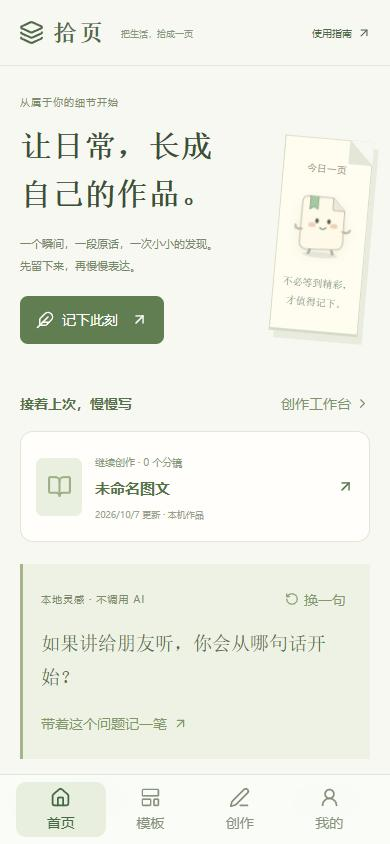
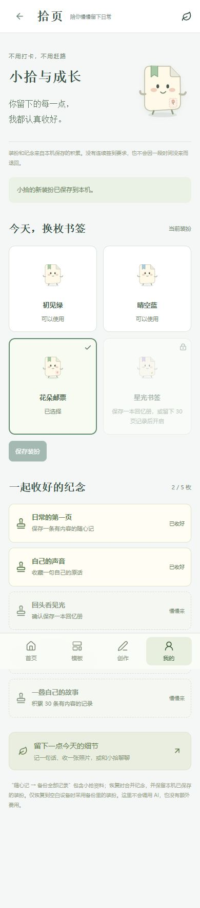

# 拾页 · Life Picker

**让日常，长成自己的作品。**

面向手机的个人创作工具：保存文字、照片和自己的原话，再把真实经历整理成多页图文、系列笔记和回忆短片。起点是“Markdown 批量转图”，核心定位逐步明确为 **帮助用户持续积累并表达自己真实而独特的内容**。

当前软件版本 **v1.10.0**。本仓库在 2026-10-17 完成从最初需求到当前版本的项目资产整理；这次整理没有增加产品功能，也没有执行公网部署。

[项目资产总索引](docs/README.md) · [需求与演变](docs/project-history.md) · [完整设计方案](docs/shiye-next-design.md) · [当前完成范围](docs/shiye-final-scope.md) · [版本归档](archives/README.md)

截图为本机浏览器测试演示，非真实用户数据；详见[截图来源](docs/assets/README.md)。

## 已实现的工作流

**记下此刻 → 收藏原话 → 整理经历 → 编排作品 → 检查导出 → 发布后回看**

| 能力 | 当前结果 |
| --- | --- |
| 图文创作 | Markdown、标题层级、封面 / 目录 / 正文 / 图解 / 封底；6 / 9 页为软目标，内容不静默删减 |
| 编辑与导出 | 单页编辑、排序、锁定、拆合、撤销、历史版本；指定页 1080px PNG、整篇 ZIP |
| 图片与记录 | 上传、移除、撤销、引用保护；随心记、日期、标签、收藏、续记、原话簿、备份恢复 |
| 模板与外观 | 12 种原创结构 + 2 种已适配开放主题；颜色与结构分开调整 |
| 小拾 | 原创 SVG 纸页精灵、保存奖励、装扮成长、情境提问、手选素材聊天 |
| 回忆 | 周 / 月 / 年选材、锁定与换组、确认快照；图文册、15～30 秒本机 MP4 |
| AI | DeepSeek 文案、分镜、单页建议、聊天、选题、视觉与回忆串联；先预览再应用、取消、预算与用量 |
| 持续创作 | 个人系列、手填发布回看、灵感来源夹、人工审核与出处 |
| 外部连接 | 本人专用 Edge 可见小红书参考；GitHub 官方 API 发现 MIT 设计候选；固定 CC0 插画核验 |

2026-10-09 的正式服务验收：小红书 6 条近期参考和 GitHub 6 个 MIT 项目进入待审核区；插画 7 项中 6 项通过，Peep 76 链接对应未通过。它们是当时的实测结果，不是实时热榜，也不表示新增了 6 个可直接套用的模板。见 [v1.10 验收](docs/acceptance-v1.10.md)。

## 在自己的电脑和 iPhone 上运行

需要 Node.js 24+、npm；个人小红书连接需要系统 Microsoft Edge，短片功能需要 FFmpeg / ffprobe。

~~~powershell
git clone https://github.com/Royal44-k/Life-Picker.git
cd Life-Picker
npm ci
npm run build
npm start
~~~

Windows 也可双击“启动拾页.cmd”。iPhone 与电脑连接同一 Wi-Fi，在 Safari 输入启动窗口显示的手机地址；连接码每次启动会变化，以当前窗口为准。不要使用历史记录里的旧地址或旧连接码。

基础排版和记录不需要 AI Key。需要 DeepSeek 时，双击“配置AI.cmd”，在本机 .env 中填写自己的密钥，再重启服务。也可使用已有免费手动提示词路径；Ollama 本地模型需自行准备。[完整使用说明](docs/user-guide.md) · [新设备交接与恢复](docs/handoff.md) · [手机图文指南](public/guide-v1.10.html)

**当前是本机单用户试用工具。** 电脑需运行，手机通常需同一 Wi-Fi。公网 HTTPS、跨设备同步和多人账户未部署。IndexedDB 中的作品和记录按设备、浏览器及访问地址分别保存，源码上传不包含这些私人内容。

## 项目资产在哪里

| 目录 | 资产 |
| --- | --- |
| src/ | React 界面、Canvas 排版、原创角色、模板、IndexedDB 数据模型、导出 |
| server/ | 本机 Node 服务、AI、来源连接、用量与短片任务 |
| tests/ | 模块、接口、真实浏览器、存储、离线、导出和异常路径验证 |
| public/ | 历代手机指南、图标、manifest、第三方许可 |
| docs/ | 需求、研究、方案、实施、发布、评审、验收和交接 |
| docs/assets/ | 资产清单、四张演示图及精选脱敏证据 |
| archives/versions/ | v1.0.0～v1.10.0 的 12 份原始版本包及校验文件 |
| scripts/ | 构建、运行准备与资产完整性核验 |
| Git 历史与标签 | 完整产品开发提交和 12 个原版本标签，含 v1.1.1 修复版 |

API Key、登录资料、浏览器私人记录、来源运行库、用量账本、依赖目录、临时日志及其他独立项目留在本机。没有重新打包或覆盖旧版本文件。

## 验证与当前边界

~~~powershell
npm test
npm run build
node scripts/verify-asset-archive.mjs
~~~

2026-10-17 归档前基线：242 / 242 项测试通过。具体历史测试与新增归档检查见[公开核验记录](docs/assets/publication-audit.md)。浏览器和短片测试的服务、日志与 FFmpeg 配置见[交接说明](docs/handoff.md)。

iPhone 13 Safari 的 HEIC、键盘、系统分享、长按与存储压力仍需真机验收；商业付费意愿、效率提升及云成本均未形成已验证结论。后续工作见[需求追踪表](docs/requirements-traceability.md)。

## 许可与来源

本次没有为拾页原创代码新增开源许可证；公开上传不代表已经选择 MIT 等许可。第三方主题保留各自原许可、固定来源和改编说明，见 [THIRD_PARTY_NOTICES.md](THIRD_PARTY_NOTICES.md)。历史调研保留原核验日期，不把当时价格、模型能力或外部接口状态当作当前保证。
